# XANES_CN_predictions

## 📌 Executive Summary

**Проблема:** Извлечение информации о локальной атомной структуре наночастиц (НЧ) традиционно требует проведения сложных и дорогостоящих экспериментов (например, данных TEM и ресурсоемкого анализа EXAFS). Спектроскопия XANES регистрируется значительно проще и дешевле, но не содержит прямых данных о координационных числах (КЧ). Кроме того, честное теоретическое моделирование спектров НЧ, содержащих тысячи атомов,  требует колоссальных вычислительных ресурсов.

**Действие:** В рамках работы был разработан ML-пайплайн для предсказания параметров локальной атомной структуры (первых N координационных чисел) по спектрам XANES. Для оптимизации расчетов были проанализированы данные для 800 наночастиц (более 5.3 млн атомов), для которых были выделены 2151 уникальных атомных подструктур и смоделированы их спектры.

**Результат:** Проведен аудит работы (Timoshenko et al., 2017) и выявлен ряд методологических ошибок. В частности, показано наличие утечки данных (*Data Leakage*) при генерации выборок, показаны ограничения предложенного авторами дескриптора уникальности подструктур и предложен более строгий метод разбиения Train/Test с использованием графовых алгоритмов.

**Стек:** Python, NumPy, SciPy, Pandas, Matplotlib, Scikit-learn, CatBoost, PyTorch, NetworkX.

---

## 🧠 Technical Deep Dive

### 1. Контекст и цель исследования
Проект представляет собой аудит и развитие методологии Timoshenko et al. (2017) [DOI: 10.1021/acs.jpclett.7b02364]. Цель — предсказание набора координационных чисел (КЧ) по спектрам XANES. В отличие от EXAFS, XANES не требует столь сложной регистрации, но их связь с локальной структурой нелинейна. Были проверены гипотезы авторов касательно выбора дескриптора, синтетической генерации данных, разбиения выборок и настройки параметров моделирования.

### 2. Пайплайн данных и оптимизация расчетов
*   **Данные:** 
    *   **Объем:** 800 НЧ (суммарно >5.3 млн атомов).
    *   **Структура:** исходные конфигурации (`init`), вырезанные из фольги (без этапа релаксации).
    *   *Благодарности:* Сбор данных и проведение расчетов выполнены при поддержке проекта РНФ № 23-21-00526.

*   **Оптимизация:** Прямой расчет спектров для всех атомов затруднителен. Для сокращения объема вычислений проведен поиск уникальных подструктур с помощью трех подходов:
    1. Метод гистограмм парного радиального распределения [DOI: 10.31857/S1028096024040045].
    2. Метод стандартизированного представления атомной структуры (`Graph_VVS`).
    3. Сопоставление упорядоченных векторов всевозможных парных расстояний и углов.
    
    Была найдена **2151 уникальная подструктура**, что позволило смоделировать полные спектры НЧ как их взвешенную сумму.

*   **Валидация и параметры расчета:**
    *   **Тестовый объект:** НЧ №140 (923 атома).
    *   **Точность:** Все спектры округлялись до 3 знаков (погрешность FDMNES — до 4-го знака).
    *   **Геометрия:** Радиус усечения (МТ) — 1.51 Å, радиус кластера для описания фольги — 7.5 Å.
    *   **Конфигурация FDMNES:**
        ```text
        Edge L3; Radius 7.5; SCF; R_self 5; Relativism; Green; Rmtg 1.51
        Плотная сетка энергий (Range):
        -10 0.1 -7 0.02 2 0.1 10 0.2 20 1 50 2 60 4 100
        ```
<details>
<summary> <b> Одновременное соответствие уникальных спектров не более чем одной уникальной группе подструктур.</b></summary>

<table>
  <tr>
    <td align="center">
      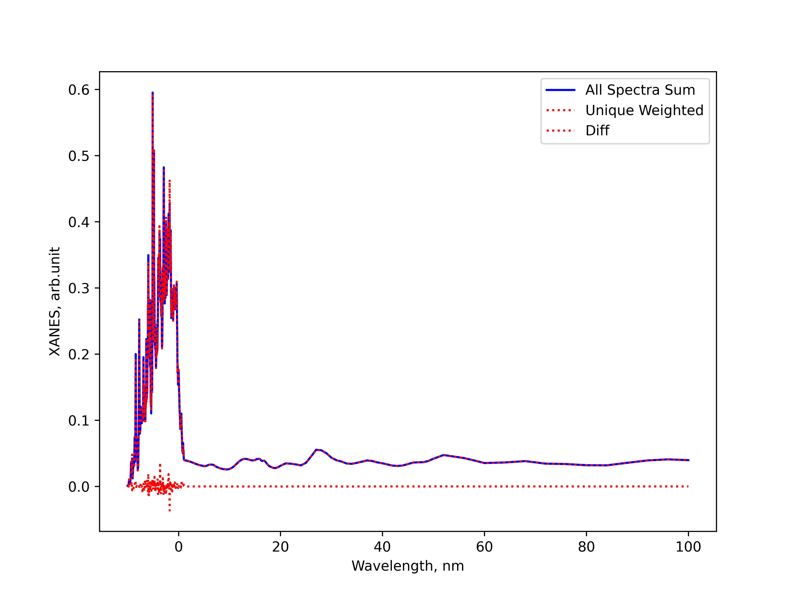<br>
      <i> Сопоставление спектров 140 НЧ полученных: как сумма по всем поглощающим возможным атомам и как взвешенная сумма по уникальным подструктурам. </i>
    </td>
    <td align="center">
      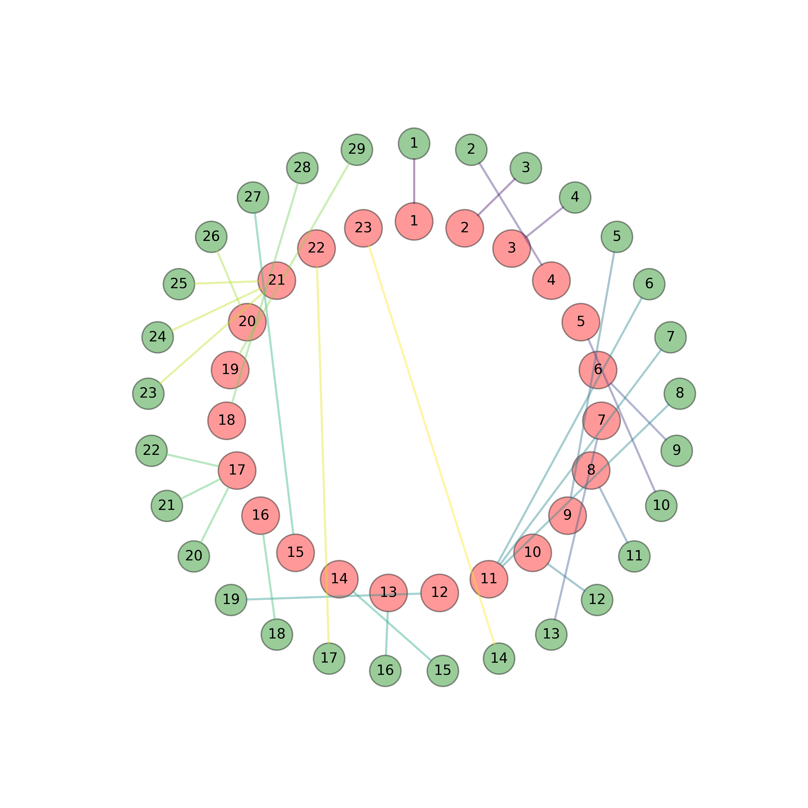<br>
      <i>Диаграмма соответствия уникальных подструктур и уникальных спектров для 140 НЧ.</i>
    </td>
  </tr>
</table>
</details>

### 3. Методологические вызовы и аудит данных

В ходе работы были выявлены четыре проблемы в подходе (Timoshenko et al.), которые могут приводить к ненадежным результатам:

<details>
<summary>❌ <b>Проблема 1: Неприменимость вектора КЧ в качестве дескриптора</b></summary>
<br>
Авторы предлагали использовать вектор КЧ для описания уникальных подструктур. В данной работе показано, что это слишком упрощенный подход: даже при равенстве всех 7 доступных КЧ спектры могут существенно различаться. Это накладывает принципиальные ограничения на точность предсказаний ML-моделей.
<br><br>
<table>
  <tr>
    <td align="center">
      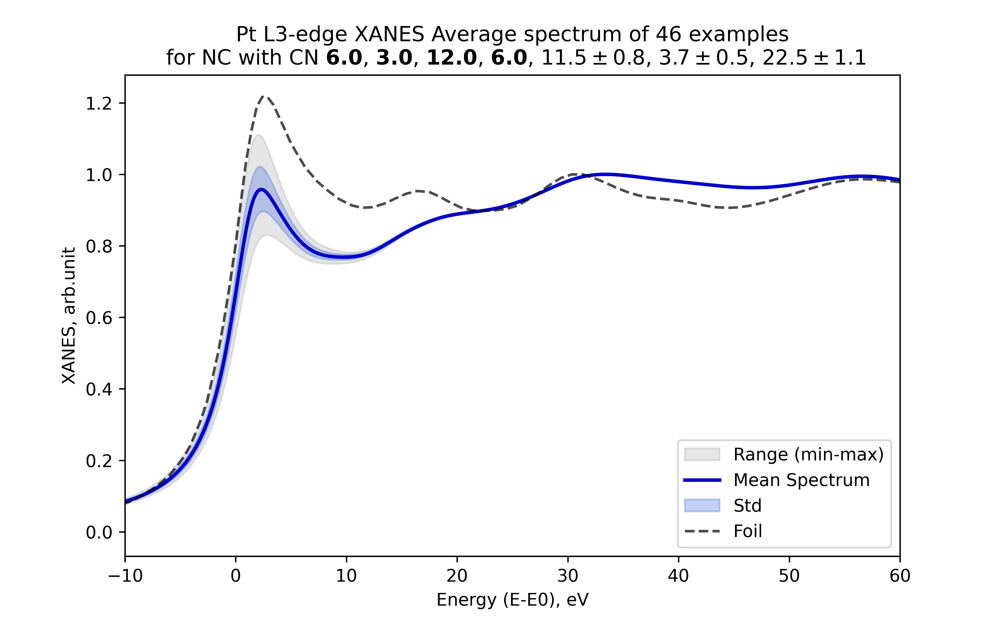<br>
      <i>Рис. 1.1 — Высокая вариативность спектров XANES при равенстве 4-х фиксированных координационных чисел.</i>
    </td>
    <td align="center">
      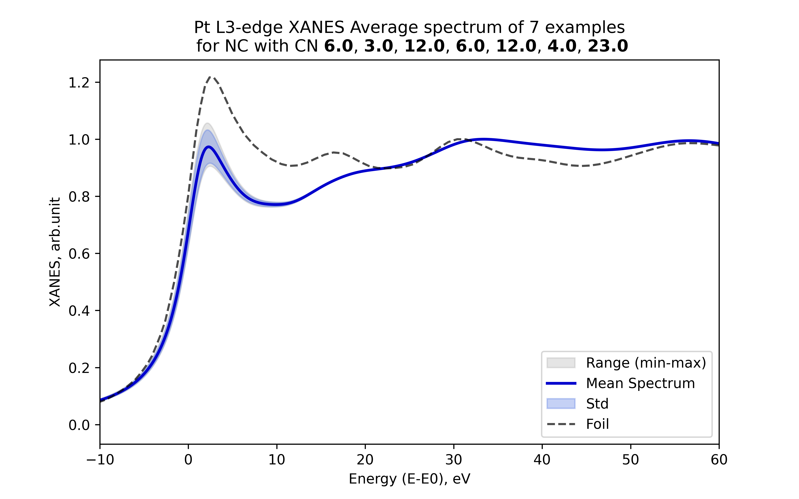<br>
      <i>Рис. 1.2 — Сохранение вариативности спектров даже при полном совпадении всех 7 координационных чисел.</i>
    </td>
  </tr>
</table>
</details>


<details>
<summary>❌ <b>Проблема 2: Параметры функции размазки для малых НЧ</b></summary>
<br>
Для объемных материалов параметры уширения (функции размазки) подбираются один раз и фиксируются. Однако для малых НЧ с их острыми и высокими пиками спектр крайне чувствителен к малейшим изменениям этих параметров. Фиксация параметров, основанная только на спектре фольги, может исказить физическую картину для малых кластеров. Для реальных НЧ, поверхностные атомы которых зачастую связываются с кислородом, одним из основных критериев правильности подбора параметров может являться монотонное уменьшение интенсивности белой линии с увеличением размера уникальной подструктуры, плавно сходясь к спектру объемного эталона. Однако в случае модельных НК, находящихся в вакууме (без какого-либо окружения НЧ) такая тенденция не обязательно является правильной или достижимой.
<br><br>
<b>Решение:</b> Желательна совместная (одновременная) оптимизация параметров уширения для всех доступных объектов, а также учет шага расчетной сетки по энергии (теорема Котельникова) для предотвращения искажения формы спектра. Т.к. положение энергии Ферми может изменяться с изменением размера и формы нанокластера (НК), для всех спектров уникальных подструктур было выполнено выравнивание края энергии с учетом разностей E_F с фольгой.
<br><br>
<table>

  <tr>
    <td align="center" valign="top">
      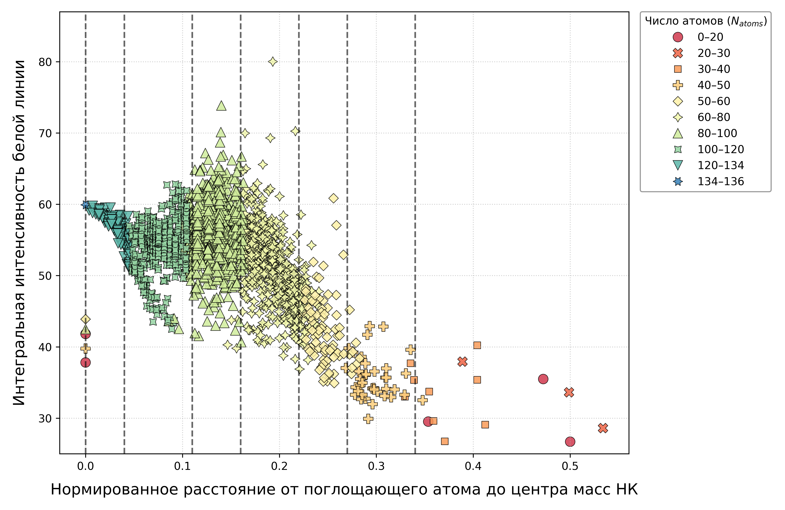<br>
      <i>Рис. 2.1 — Зависимость интенсивности белой линии спектра от расстояния между поглощающим атомом и центром масс системы (НК).</i>
    </td>
    <td align="center" valign="top">
      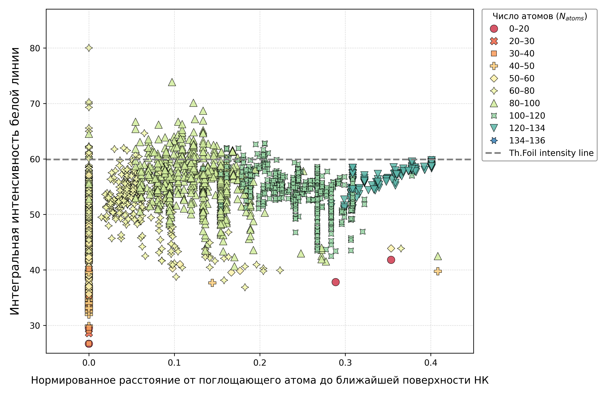<br>
      <i>Рис. 2.2 — Зависимость интенсивности белой линии спектра от расстояния между поглощающим атомом и поверхностью НК.</i>
    </td>
  </tr>

  <tr>
    <td colspan="2" align="center">
      <br>
      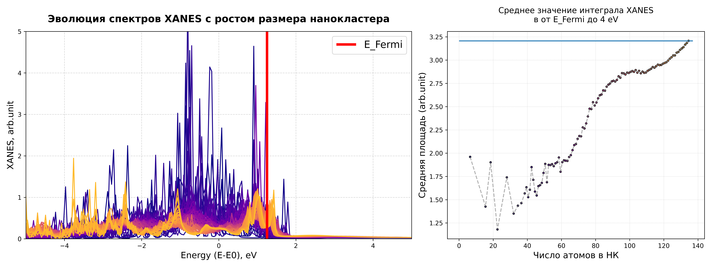<br>
      <i>Рис. 2.3 — Стабилизированное положение E_F для всего набора уникальных подструктур с учетом выравнивания края поглощения.</i>
    </td>
  </tr>
</table>
</details>

<details>
<summary>❌ <b>Проблема 3: Синтетические данные без реалистичного прообраза НЧ</b></summary>
<br>
Подход из оригинальной статьи (смешивание 3 случайных уникальных подструктур) не гарантирует наличия реалистичного прообраза синтетической НЧ, что снижает применимость результатов к реальным данным.
Кроме того при смешении по 3 подструктуры распределение целевых меток значительно отличается от нормального.
<br><br>
<b>Решение:</b> Альтернативой является аугментация базисных представлений модельных НЧ, полученных путем вырезания из фольги (незначительное возмущение весов подструктур или их замена на подструктуры с близким количеством атомов). При смешении желательно использовать более 5 уникальных подструктур.
<br><br>
<table>
<tr>
    <td align="center" valign="top">
      <br>
      <i>Рис. 3.1 — Распределение целевых меток при смешении по 3 подструктуры.</i>
    </td>
</tr>
<tr>
    <td align="center" valign="top">
      <br>
      <i>Рис. 3.2 — Распределение целевых меток при смешении по 4 подструктуры.</i>
    </td>
</tr>
<tr>
    <td align="center" valign="top">
      <br>
      <i>Рис. 3.3 — Распределение целевых меток при смешении по 5 подструктуры.</i>
    </td>
</tr>
<tr>
    <td align="center" valign="top">
      <br>
      <i>Рис. 3.4 — Распределение целевых меток при смешении по 25 подструктуры.</i>
    </td>
</tr>
</table>
<details>
<summary><b> Важность признаков </b></summary>
<table>
<tr>
    <td align="center" valign="top">
      <br>
      <i>Рис. 3.5 — Важность признаков Lasso для Scenario 1 (синтетическая смесь по 3)</i>
    </td>
    <td align="center" valign="top">
      <br>
      <i>Рис. 3.6 — Важность признаков Lasso для Scenario 2 (реалистичные прообразы)</i>
    </td>
    <td align="center" valign="top">
      <br>
      <i>Рис. 3.7 — Важность признаков Lasso для Scenario 3 (реалистичные прообразы и смеси)</i>
    </td>
</tr>
<tr>
    <td align="center" valign="top">
      <br>
      <i>Рис. 3.8 — Важность признаков ExtraTrees для Scenario 1 (синтетическая смесь по 3)</i>
    </td>
    <td align="center" valign="top">
      <br>
      <i>Рис. 3.9 — Важность признаков ExtraTrees для Scenario 2 (реалистичные прообразы)</i>
    </td>
    <td align="center" valign="top">
      <br>
      <i>Рис. 3.10 — Важность признаков ExtraTrees для Scenario 3 (реалистичные прообразы и смеси)</i>
    </td>
</tr>
</table>
</details>

</details>

<details>
<summary>❌ <b>Проблема 4: Утечка данных <i>(Data Leakage)</i> и проблемы наивного разбиения</b> </summary>
<br>
При случайном разбиении (Scenario 1A, 2A) все модели показывали обманчиво идеальные метрики из-за утечки данных (одни и те же подструктуры попадали в train и test). 
<br>
Использование метода наивного Lauvian_communities без жесткой резервации малых НЧ (которые представлены изолированными подграфами) приводит к тому, что в окрестностях некоторых тестовых кластеров в UMAP нет ни одной точки данных, доступной в процессе обучения.
<br><br>
<b>Решение:</b> Предложен алгоритм разбиения (Scenario 2B) с принудительной резервацией краевых (малых и крупных) НЧ за Train выборкой. Это обеспечило наличие точек вблизи любого тестового кластера и честную отложенную выборку (Scenario 3).
<br><br>
<details>
<summary> <b> Аудит распределения уникальных подструктур по Train/Test наборам </b> </summary>
<table>
<tr>
    <td align="center" valign="top">
      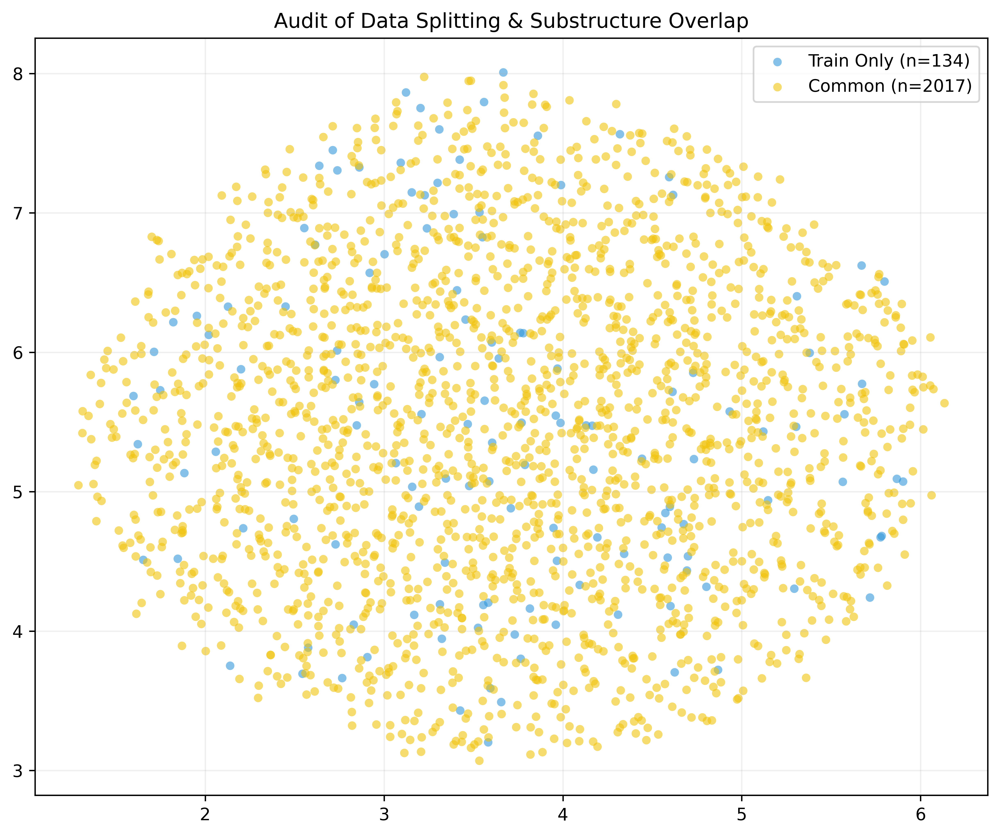<br>
      <i>Рис. 4.1 — Аудит распределения уникальных подструктур по Train/Test наборам при "наивном" разбиении предложенным в [DOI: 10.1021/acs.jpclett.7b02364].</i>
    </td>
</tr>
<tr>
    <td align="center" valign="top">
      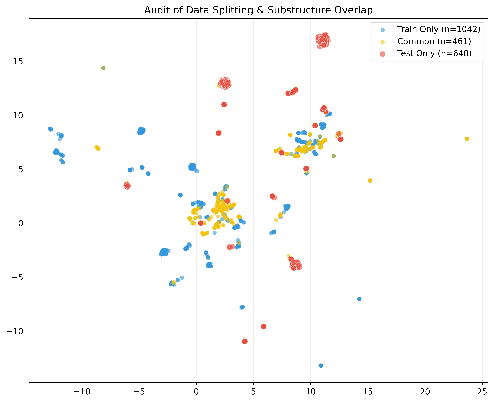<br>
      <i>Рис. 4.2 — Аудит распределения уникальных подструктур по Train/Test наборам методом Lauvian_communities без резервации краевых НЧ.</i>
    </td>
</tr>
<tr>
    <td align="center" valign="top">
      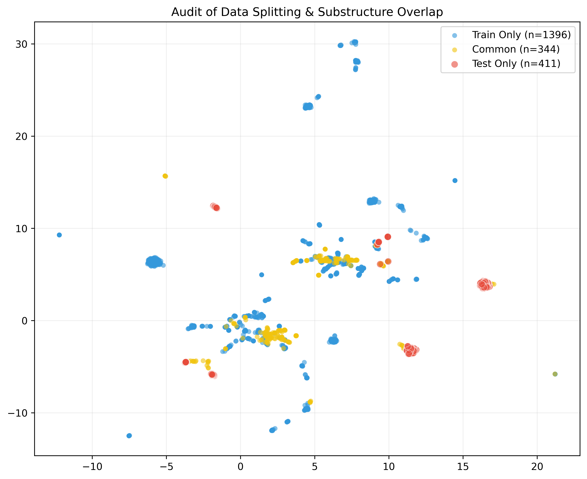<br>
      <i>Рис. 4.3 — Аудит распределения уникальных подструктур по Train/Test наборам методом Lauvian_communities с резервацией краевых НЧ.</i>
    </td>
</tr>
</table>
</details>
<br>
<b>Примечание:</b> Т.к. и спектр и набор целевых метрик НЧ является взвешенной суммой спектров и векторов КЧ уникальных подструктур, то для предсказания модель может провести линейное разложение спектра НЧ по известному ей базису, поэтому для оценки её обобщающей способности необходимо ограничить её доступ к полному набору базовых спектров. Логично ожидать, что при утечке данных линейные модели будут давать практически идеальную точность, но при более строгом разбиении и сдвиге данных они могут сильно ошибаться.

<table>
<tr>
    <td align="center" valign="top">
      <br>
      <i>Рис. 4.4 — Значения MAE для различных моделей, обученных на синтетических смесях по 3 подструктуры в рамках Scenario 1A (наивное разбиение).</i>
    </td>
</tr>
<tr>
    <td align="center" valign="top">
      <br>
      <i>Рис. 4.5 — Значения MAE для различных моделей обученных  на синтетических смесях по 3 подструктуры в рамках Scenario 1B (генерация Train/Test из непересекающихся наборов подструктур).</i>
    </td>
</tr>
<tr>
    <td align="center" valign="top">
      <br>
      <i>Рис. 4.6 — Значения MAE для различных моделей обученных на синтетических НЧ с реалистичным прообразами в рамках Scenario 2A (наивное разбиение).</i>
    </td>
</tr>
<tr>
    <td align="center" valign="top">
      <br>
      <i>Рис. 4.7 — Значения MAE для различных моделей обученных на синтетических НЧ с реалистичным прообразами в рамках Scenario 2B (Lauvian с резервацией).</i>
    </td>
</tr>
</table>
</details>

### 4. Прямое сравнение с результатами [DOI: 10.1021/acs.jpclett.7b02364]
<b> Основная трудность сопоставления результатов заключается в отсутствии доступа к полным данным из работы Timoshenko et al. (2017) и наличии существенных различий с нашими данными </b>
<details>
<summary>⚠️ <b>Проблема 1: подготовка оцифрованных данных </b></summary>
При оцифровке спектры получаются более зашумленными по сравнению как с экспериментом, так и первопринципными расчётами. Также оцифрованные данные приводятся в относительных единицах.<br><br>
<b>Простое решение:</b> Игнорирование шума или простое сглаживание, а также приведение оцифрованных спектров к "ожидаемому" виду с использованием данных о теоретическом спектре фольги.<br>
<details>
<summary><b>"Выровненные" спектры</b></summary>
      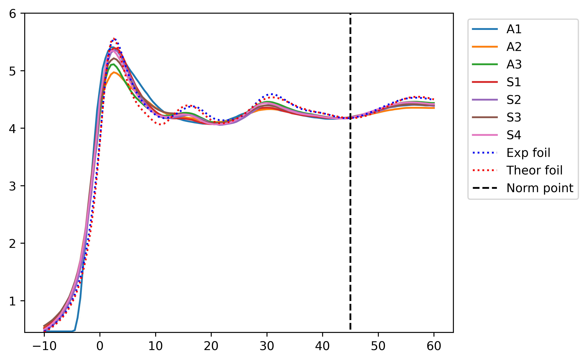<br>
      <i>Согласованные с обучающими данными экспериментальные спектры.</i>
</details>
<br>
<b>Более правильное решение:</b> Переход от спектров полученных в единицах FDMNESS к нормированному виду с жестким выравниванием по краю поглощения. Добавление аугментаций со случайным шумом и относительным изменением интенсивности спектра или переход к виду данных не зависящему от интенсивности.<br><br>
</details>
<details>
<summary>⚠️ <b>Проблема 2: Краевые значения целевых меток </b></summary>
Целевые значения КЧ для большинства экспериментальных спектров находятся на краях распределений наших данных. Более того, эти хвосты в основном сформированы синтетическими смесями уникальных подструктур, лишь малая часть которых реально относится к малым НЧ. Также стоит отметить, что размеры экспериментальных НЧ весьма малы (менее 3 нм), данных для которых в нашем наборе не так много (~60 объектов).<br>
<details>
<summary><b>Графики распределений</b></summary>
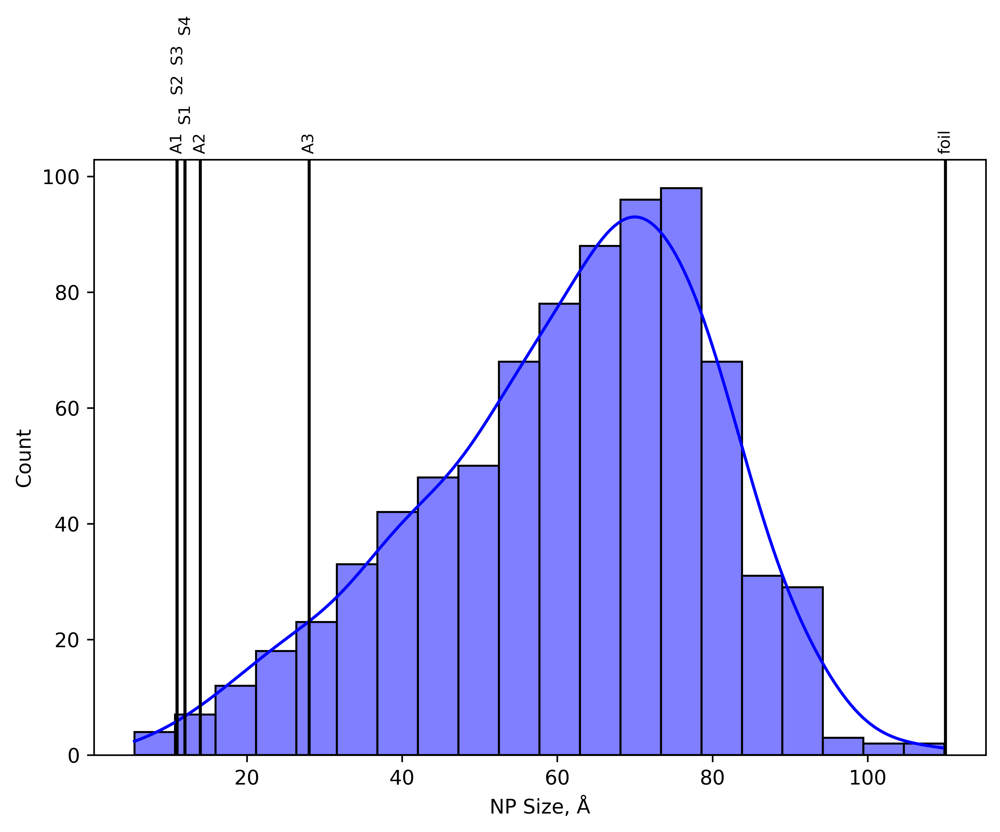
<br>
<table>
<tr>
    <td align="center" valign="top">
      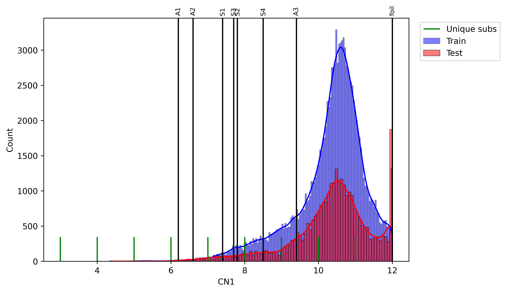
    </td>
    <td align="center" valign="top">
      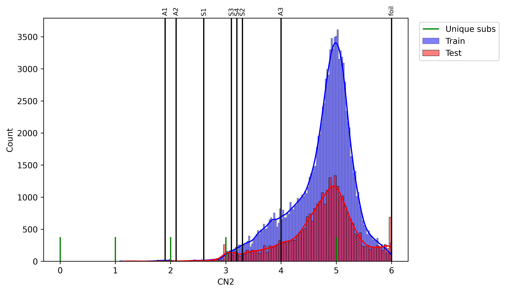
    </td>
</tr>
<tr>
    <td align="center" valign="top">
      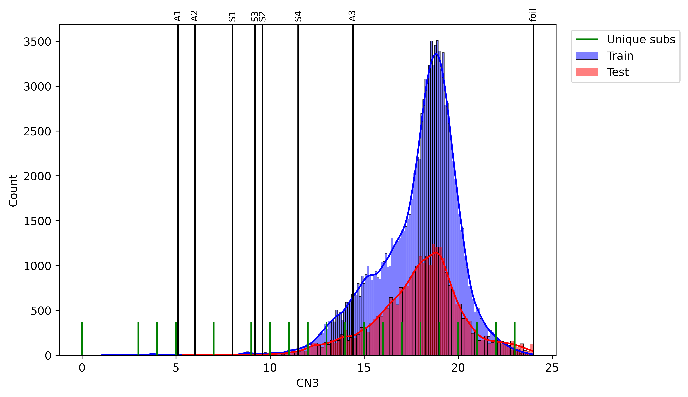
    </td>
    <td align="center" valign="top">
      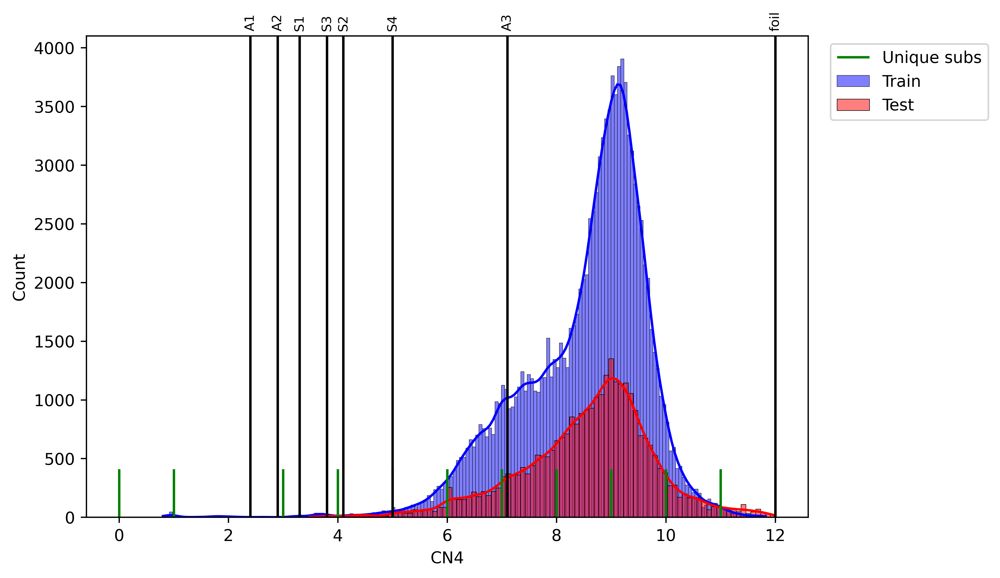
    </td>
</tr>
</table>
</details>
</details>

<details>
<summary>⚠️ <b>Проблема 3: Различия в тенденциях белой линии </b></summary>
В наших данных для малых НЧ наблюдается заметное уменьшение интенсивности белой линии в спектре, в то время как экспериментальные данные из работы  Timoshenko et al. (2017) близки к фольге, что затрудняет использование обученных нами моделей.
<details>
<summary><b>Визуализация спектров</b></summary>
<table>
<tr>
    <td align="center" valign="top">
      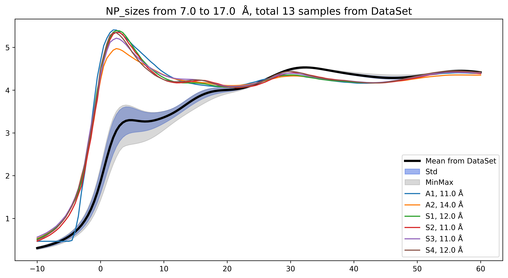
    </td>
    <td align="center" valign="top">
      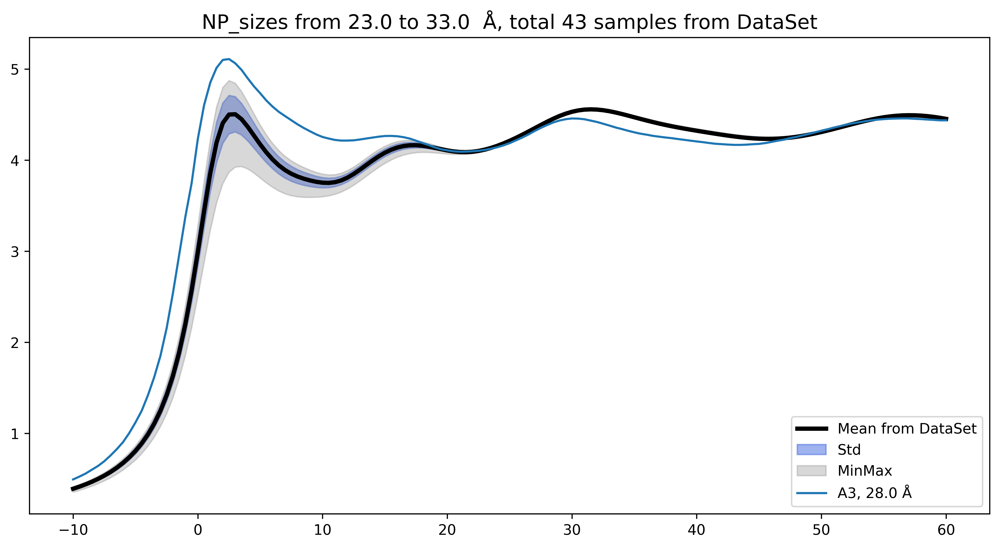 2 nm" width="600"/>
    </td>
</tr>
</table>
</details>
</details>

<details>
<summary>⚠️ <b> Сопоставление результатов </b></summary>
Согласно данным о важности признаков почти все модели во многом ориентируются на область спектра вблизи края поглощения. Однако для этой области наблюдается существенный сдвиг данных. В качестве потенциального решения можно переобучить модели на данных с маскированной околокраевой областью, однако это приведет к заметному ухудшению их качества (дальняя область для большинства спектров, в том числе и экспериментальных практически совпадает).
Поэтому для сопоставления мы использовали модель CNN_with_std:<br>
 2 nm" width="600"/><br>
</details>
<br>
<b>Заключение по разделу:</b><br>
Прямое сопоставление с имеющимися литературными данными не ставилось в качестве основной цели данного исследования. Тем не менее, в случае необходимости, для корректного сравнения наших результатов с экспериментальными данными из работы [DOI: 10.1021/acs.jpclett.7b02364] требуется расширить датасет за счет малых наночастиц (НЧ) и учесть влияние их локального окружения. Дополнительно повысить воспроизводимость и упростить сопоставление с новыми спектральными данными позволят расширенная аугментация выборки и предварительная стандартизация спектров XANES.


### 5. Модели и Результаты
*   **Baseline:** Linear Regression, Lasso, Ridge, CatBoostRegressor, ExtraTreesRegressor.
*   **Deep Learning:** MLP (архитектура как в оригинальной статье [DOI: 10.1021/acs.jpclett.7b02364] (~200к параметров)) и 1D-CNN (~50к параметров). 
*   **Итог:** При нестрогом разбиении данных все модели, за исключением CatBoost и ExtraTrees, выдают одинаковые метрики (R2,MAE) в рамках доступных наборов данных (train/val/test). При более строгом разбиении метрики на тестовой выборке заметно падают. Распределения важности признаков для наивного и более строгого разбиения данных демонстрируют схожее поведение. Распределение важности признаков для синтетических смесей по 3-5 подструктур и НЧ с реалистичными прообразами заметно отличаются. Оптимальным способом генерации данных является комбинирование подходов синтетических смесей и "реалистичных" НЧ, в таком случае некоторые важные признаки характерные для разных способов генерации отпадают или заменяются новыми. Учет аугментаций спектров также оказывает значительное влияние на распределения важности признаков.
*   **Вывод:** Проведенный аудит данных и процедуры разбиения показывает, что метрики оригинальной статьи [DOI: 10.1021/acs.jpclett.7b02364] были завышены.


## 📂 Структура репозитория

* `01_EDA_and_Domain/` — разведочный анализ данных, физическая валидация аддитивности спектров, анализ уникальных атомных подструктур и настройка параметров функции уширения.
* `02_Modeling_and_Leakage/` — генерация синтетических выборок, аудит утечки данных (*Data Leakage*), графовое разбиение выборок (`Louvain` с резервацией краевых НЧ) и обучение моделей (Linear/Ridge/Lasso, CatBoost, ExtraTrees, MLP, 1D-CNN).
* `03_Augmentation_and_Robustness/` — обучение и оценка моделей на аугментированных данных и сопоставление предсказаний с экспериментальными данными из литературы.
* `src/` — вспомогательные модули и функции для обработки спектров, расчета дескрипторов и визуализации.
* `images/` & `processed_data/` — сохраненные графики, карты важности признаков (*Feature Importance*) и сводные метрики экспериментов.

## 🚀 Быстрый старт

```bash
git clone git clone https://github.com/Veretas54/XANES_CN_predictions.git
cd XANES_CN_predictions
pip install -r requirements.txt
```
