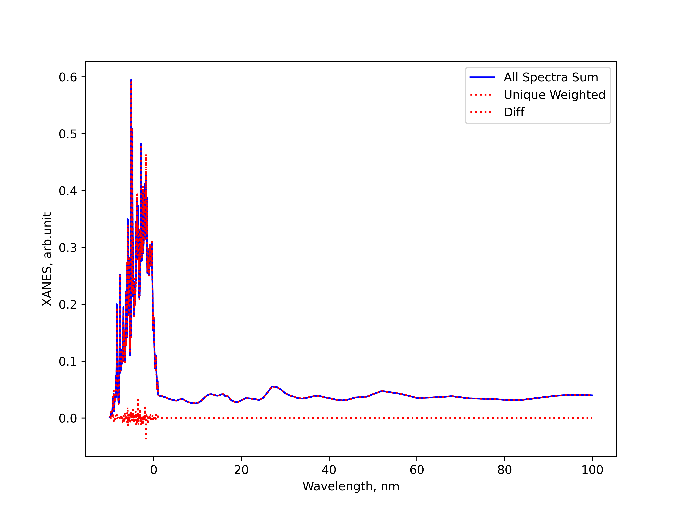
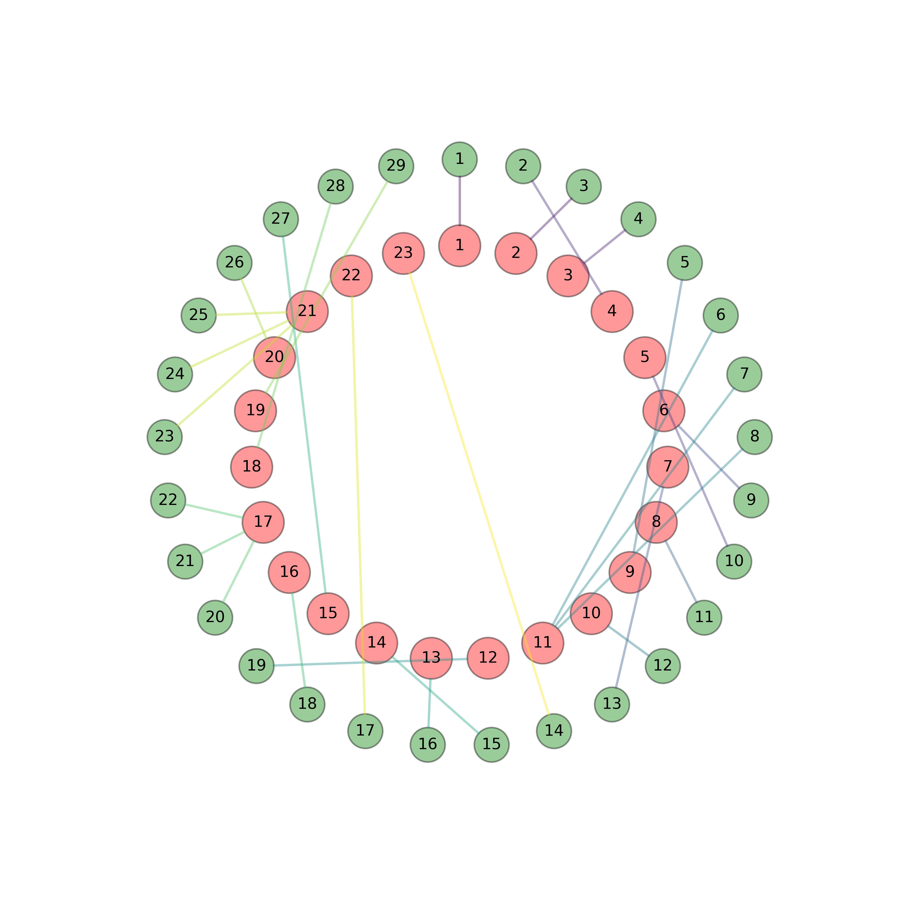
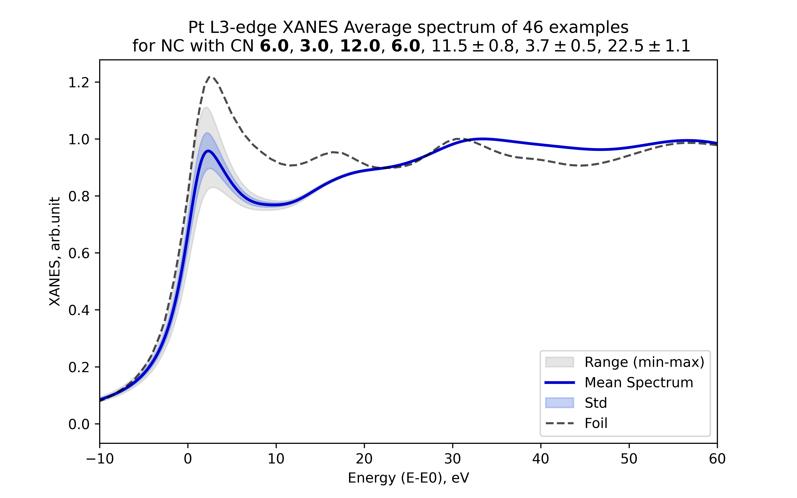
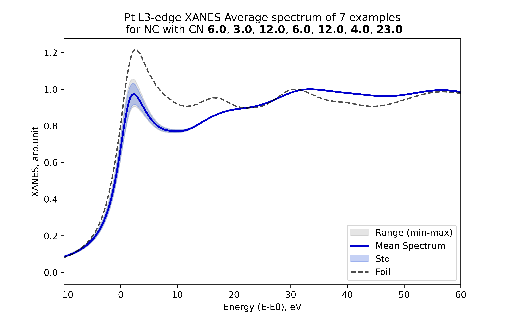
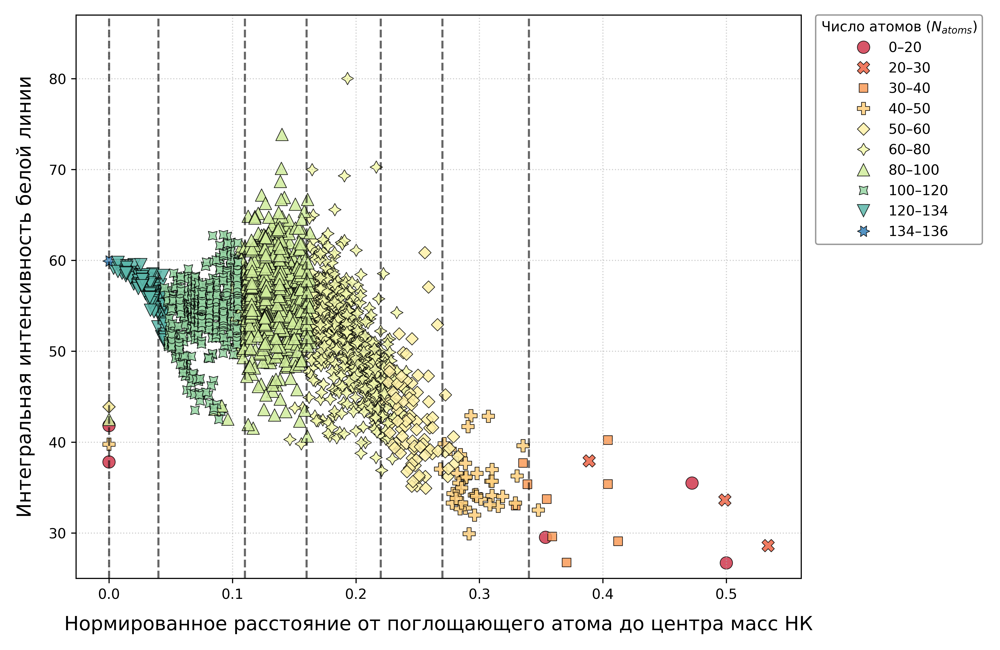
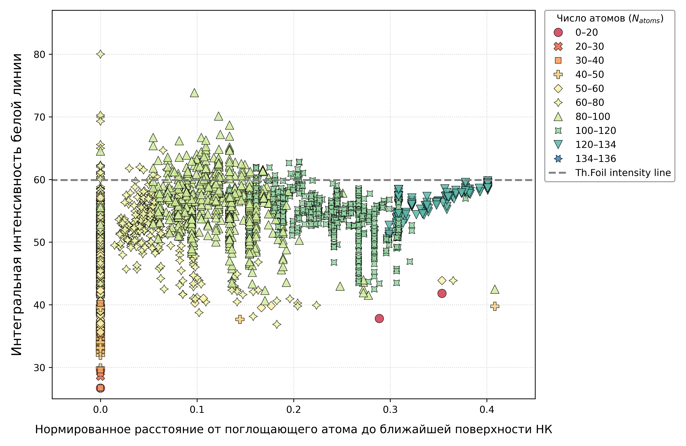
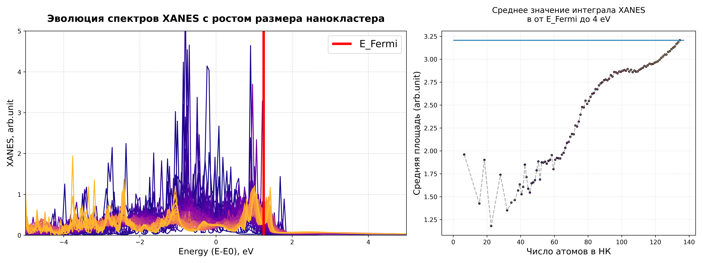
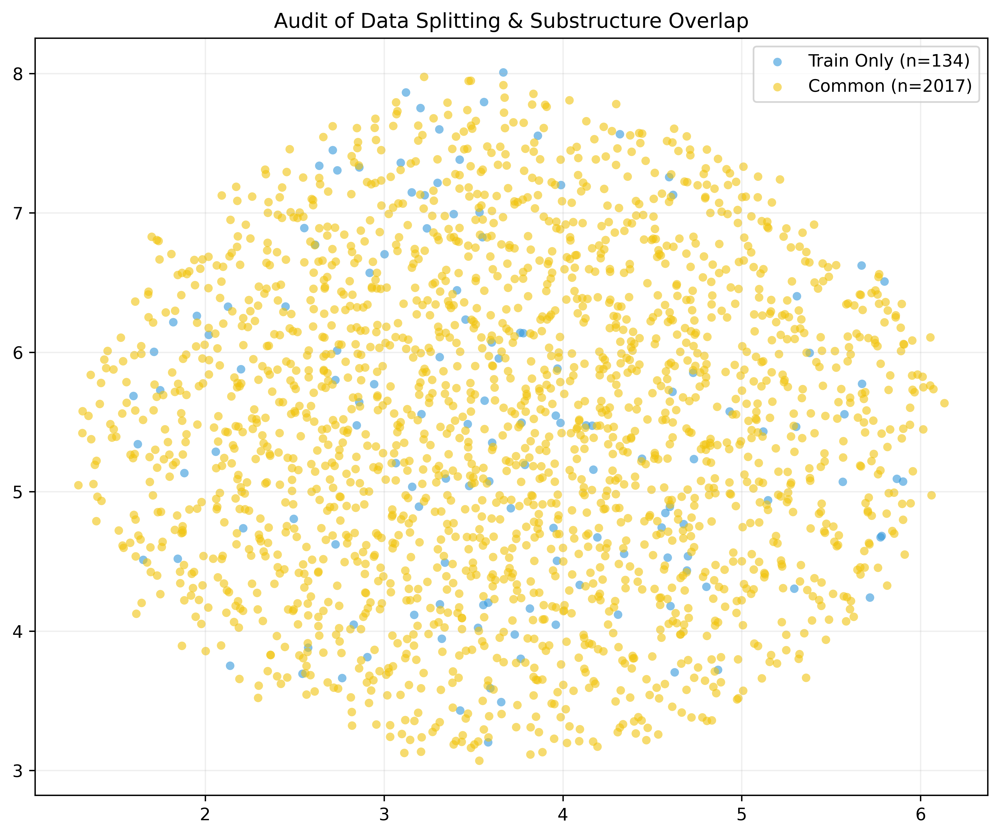
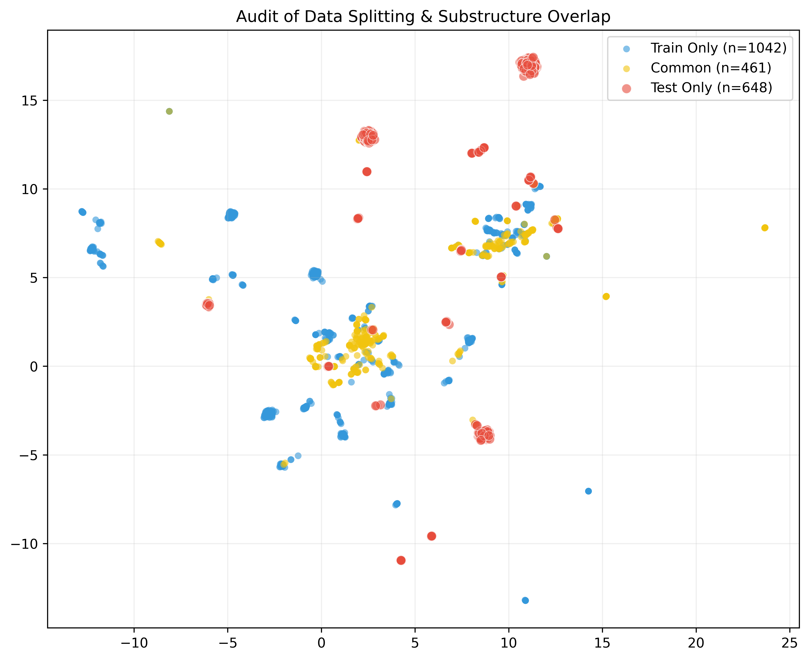
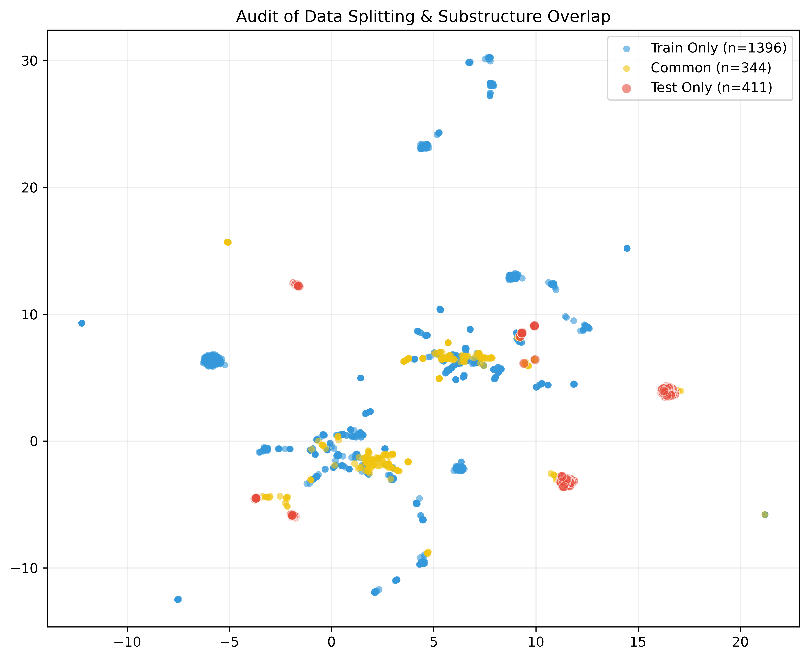

# XANES_CN_predictions

## 📌 Executive Summary

**Проблема:** Извлечение информации о локальной атомной структуре наночастиц (НЧ) традиционно требует проведения сложных и дорогостоящих экспериментов (например, данных TEM и ресурсоемкого анализа EXAFS). Спектроскопия XANES регистрируется значительно проще и дешевле, но не содержит прямых данных о координационных числах (КЧ). Кроме того, честное теоретическое моделирование спектров НЧ, содержащих тысячи атомов,  требует колоссальных вычислительных ресурсов.

**Действие:** В рамках работы был разработан ML-пайплайн для предсказания параметров локальной атомной структуры (первых N координационных чисел) по спектрам XANES. Для оптимизации расчетов были проанализированны данные для 800 наночастиц (более 5.3 млн атомов), для которых были выделены 2151 уникальных атомных подструктур и смоделировали их спектры.

**Результат:** Проведен аудит пионерской работы (Timoshenko et al., 2017) и выявилен ряд фундаментальных методологических ошибок. В частности, показано наличие утечки данных (Data Leakage) при генерации выборок, показаны ограничения предложенного авторами дескриптора уникальности подструктур и предложен более строгий метод разбиения Train/Test с использованием графовых алгоритмов.

**Стек:** Python, Scikit-learn, CatBoost, PyTorch, Pandas, Matplotlib, numpy, scipy, NetworkX.

---

## 🧠 Technical Deep Dive

### 1. Контекст и цель исследования
Проект представляет собой критический аудит и развитие методологии Timoshenko et al. (2017) [DOI: 10.1021/acs.jpclett.7b02364]. Цель — предсказание набора координационных чисел (КЧ) по спектрам XANES. В отличие от EXAFS, XANES не требует столь сложной регистрации, но их связь с локальной структурой нелинейна. Были проверены гипотезы авторов касательно выбора дескриптора, синтетической генерации данных, разбиения выборок и настройки параметров моделирования.

### 2. Пайплайн данных и оптимизация расчетов
*   **Данные:** 800 НЧ (суммарно >5.3 млн атомов). Используются исходные структуры («init»), вырезанные из фольги (без этапа релаксации).
*   **Оптимизация:** Прямой расчет спектров для всех атомов невозможен. Был проведен поиск уникальных подструктур (с использованием метода гистограмм парного радиального распределения [DOI: 10.31857/S1028096024040045], метода стандартизированного представления атомной структуры (Graph_VVS) и сопоставления упорядоченных векторов всевозможных парных расстояний и углов). Найдена **2151 уникальная подструктура**, что позволило честно смоделировать спектры НЧ как взвешенную сумму спектров подструктур.
*   **Валидация:** Проверка на НЧ #140 (923 атома). Установлено, что FDMNES дает погрешность до 4-го знака, поэтому все спектры округлялись до 3-х знаков. Радиус усечения (МТ) — 1.5, радиус кластера для описания фольги — 7.5 Å.

<table>
  <tr>
    <td align="center">
       
      <i> Сопоставление спектров 140 НЧ полученных: как сумма по всем поглощающим возможным атомам и как взвешенная сумма по уникальным подструктурам. </i>
    </td>
    <td align="center">
       
      <i>Диаграмма соответствия уникальных подструктур и уникальных спектров для 140 НЧ.</i>
    </td>
  </tr>
</table>

### 3. Методологические вызовы и аудит данных

В ходе работы мы выявили четыре фундаментальных проблемы в подходе (Timoshenko et al.), которые приводят к ненадежным результатам:

❌ <b>Проблема 1: Неприменимость вектора КЧ в качестве дескриптора</b>

 
Авторы предлагали использовать вектор КЧ для описания уникальных подструктур. Мы показали, что это слишком упрощенный подход: даже при равенстве всех 7 доступных КЧ (включая вакансии) спектры могут существенно различаться. Это накладывает принципиальные ограничения на точность предсказаний ML-моделей.
  
<table>
  <tr>
    <td align="center">
       
      <i>Рис. 1.1 — Высокая вариативность спектров XANES при равенстве 4-х фиксированных координационных чисел.</i>
    </td>
    <td align="center">
       
      <i>Рис. 1.2 — Сохранение вариативности спектров даже при полном совпадении всех 7 координационных чисел.</i>
    </td>
  </tr>
</table>

❌ <b>Проблема 2: Параметры функции размазки для малых НЧ</b>

 
Для объемных материалов параметры уширения (функции размазки) подбираются один раз и фиксируются. Однако для малых НЧ с их острыми и высокими пиками спектр крайне чувствителен к малейшим изменениям этих параметров. Фиксация параметров, основанная только на спектре фольги, может исказить физическую картину для малых кластеров. Для реальных НЧ, поверхностные атомы которых зачастую связываются с кислородом, одним из основных критериев правильности подбора параметров может является монотонное уменьшение интенсивности белой линии с увеличением размера уникальной подструктуры, плавно сходясь к спектру объемного эталона. Однако в случае модельных НК находящихся в вакууме (без какого-либо окружения НЧ) такая тенденция не обязательно является правильной или достижимой.
  
<b>Решение:</b> Желательна совместная (одновременная) оптимизация параметров уширения для всех доступных объектов, а также учет шага расчетной сетки по энергии (теорема Котельникова) для предотвращения искажения формы спектра. Т.к. положение энергии Ферми может изменяться с изменением размера и формы нанокластера (НК), поэтому для всех спектров уникальных подструктур было выполнено выравнивание края энергии с учетом разностей EF по фольге.
  
<table>

  <tr>
    <td align="center" valign="top">
       
      <i>Рис. 2.1 — Зависимость интенсивности белой линии спектра от расстояния между поглощающим атомом и центром масс системы (НК).</i>
    </td>
    <td align="center" valign="top">
       
      <i>Рис. 2.2 — Зависимость интенсивности белой линии спектра от расстояния между поглощающим атомом и поверхностью НК.</i>
    </td>
  </tr>

  <tr>
    <td colspan="2" align="center">
       
       
      <i>Рис. 2.3 — Стабильное положение EF для всего набора уникальных подструктур с учетом выравнивания края поглощения.</i>
    </td>
  </tr>
</table>

❌ <b>Проблема 3: Синтетические данные без реалистичного прообраза НЧ</b>

 
Подход из оригинальной статьи (смешивание 3 случайных уникальных подструктур) не гарантирует наличия реалистичного прообраза синтетической НЧ, что снижает применимость результатов к реальным данным.
Кроме того при смешении по 3 подструктуры распределение целевых меток значительно отличается от нормального.
  
<b>Решение:</b> Альтернативой является аугментация базисных представлений модельных НЧ, полученных путем вырезания из фольги (незначительное возмущение весов подструктур или их замена на подструктуры с близким количеством атомов). При смешении использовать более 5 уникальных подструктур.
  
<table>
<tr>
    <td align="center" valign="top">
       
      <i>Рис. 3.1 — Распределение целевых меток при смешении по 3 подструктуры.</i>
    </td>
</tr>
<tr>
    <td align="center" valign="top">
       
      <i>Рис. 3.2 — Распределение целевых меток при смешении по 4 подструктуры.</i>
    </td>
</tr>
<tr>
    <td align="center" valign="top">
       
      <i>Рис. 3.3 — Распределение целевых меток при смешении по 5 подструктуры.</i>
    </td>
</tr>
<tr>
    <td align="center" valign="top">
       
      <i>Рис. 3.4 — Распределение целевых меток при смешении по 25 подструктуры.</i>
    </td>
</tr>
</table>

❌ <b>Проблема 4: Утечка данных (Data Leakage) и проблемы наивного разбиения</b> 

 
При случайном разбиении (Scenario 1A, 2A) все модели показывали обманчиво идеальные метрики из-за утечки данных (одни и те же подструктуры попадали в train и test). 
 
Использование метода наивного Lauvian_communities без жесткой резервации малых НЧ (которые представлены изолированными подграфами) приводит к тому, что в окрестностях некоторых тестовых кластеров в UMAP нет ни одной точки данных, доступной в процессе обучения.
  
<b>Решение:</b> Предложен алгоритм разбиения (Scenario 2B) с принудительной резервацией краевых (малых и крупных) НЧ за Train выборкой. Это обеспечило наличие точек вблизи любого тестового кластера и честную отложенную выборку (Scenario 3).
  

 <b> Аудит распределения уникальных подструктур по Train/Test наборам</b> 

<table>
<tr>
    <td align="center" valign="top">
       
      <i>Рис. 4.1 — Аудит распределения уникальных подструктур по Train/Test наборам при "наивном" разбиении предложенным в [DOI: 10.1021/acs.jpclett.7b02364].</i>
    </td>
</tr>
<tr>
    <td align="center" valign="top">
       
      <i>Рис. 4.2 — Аудит распределения уникальных подструктур по Train/Test наборам методом Lauvian_communities без резервации краевых НЧ.</i>
    </td>
</tr>
<tr>
    <td align="center" valign="top">
       
      <i>Рис. 4.3 — Аудит распределения уникальных подструктур по Train/Test наборам методом Lauvian_communities с резервацией краевых НЧ.</i>
    </td>
</tr>
</table>

<table>
<tr>
    <td align="center" valign="top">
       
      <i>Рис. 4.4 — Значения MAE для различных моделей обученных на синтетических смесях по 3 подструктуры в рамках Scenario 1A (наивное разбиение).</i>
    </td>
</tr>
<tr>
    <td align="center" valign="top">
       
      <i>Рис. 4.5 — Значения MAE для различных моделей обученных  на синтетических смесях по 3 подструктуры в рамках Scenario 1B (генерация Train/Test из непересекающихся наборов подструктур).</i>
    </td>
</tr>
<tr>
    <td align="center" valign="top">
       
      <i>Рис. 4.6 — Значения MAE для различных моделей обученных на синтетических НЧ с реалистичным прообразами в рамках Scenario 2A (наивное разбиение).</i>
    </td>
</tr>
<tr>
    <td align="center" valign="top">
       
      <i>Рис. 4.7 — Значения MAE для различных моделей обученных на синтетических НЧ с реалистичным прообразами в рамках Scenario 2B (Lauvian с резервацией)..</i>
    </td>
</tr>
</table>

### 4. Модели и Результаты
*   **Baseline:** Linear Regression, Lasso, Ridge, CatBoostRegressor, ExtraTreesRegressor.
*   **Deep Learning:** MLP (архитектура как в оригинальной статье [DOI: 10.1021/acs.jpclett.7b02364] (~200к параметров)) и 1D-CNN (~50к параметров). 
*   **Итог:** При не строгом разбиении данных все модели, за исключением CatBoost и ExtraTrees, выдают одинаковые метрики (R2,MAE) в рамках доступных наборов данных (train/val/test). При более строгом разбиении метрики на Test'овом наборе заметно падают. Расрпеделения важности признаков для наивного и более строгого разбиения данных демонстрируют схожее поведение. Распределение важности признаков для синтетических смесей по 3-5 подструктур и НЧ с реалистичными прообразами заметно отличаются. Оптимальным способом генерации данных является комбинирование подходов синтетических смесей и "реалистичных" НЧ, в таком случае некоторые важные признаки характерные для разных способов генерации отпадают или заменяются новыми. Учет аугментаций спектров также оказывает значительное влияние на распределения важности признаков.
*   **Вывод:** Проведенный аудит данных и процедуры разбиения показывает, что метрики оригинальной статьи [DOI: 10.1021/acs.jpclett.7b02364] были завышены.
